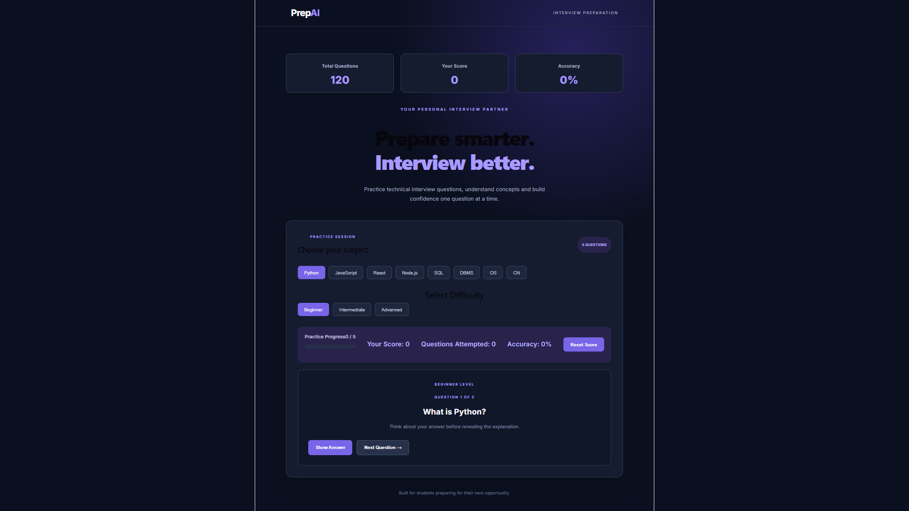

# PrepAI – Interview Preparation Assistant

PrepAI is a full-stack web application designed to help students prepare for technical interviews through subject-wise questions, difficulty levels, answer explanations, and performance tracking.

## 🚀 Features

- Subject-wise technical interview questions
- 8 technical subjects
- Beginner, Intermediate, and Advanced difficulty levels
- Show and hide answer explanations
- Track correct and incorrect answers
- Automatic score and accuracy calculation
- Practice progress bar
- Reset practice score
- Save progress using browser Local Storage
- Responsive user interface

## 💻 Technologies Used

**Frontend**
- React.js
- JavaScript
- HTML5
- CSS3
- Vite

**Backend**
- Node.js
- Express.js
- REST API
- CORS

**Storage**
- Browser Local Storage

## 📚 Subjects Available

1. Python
2. JavaScript
3. React
4. Node.js
5. SQL
6. DBMS
7. Operating Systems
8. Computer Networks

## 📁 Project Structure

```text
AI-Interview-Assistant/
├── backend/
│   └── server.js
├── frontend/
│   ├── src/
│   │   ├── App.jsx
│   │   ├── App.css
│   │   └── main.jsx
│   └── package.json
├── README.md
├── package.json
└── .gitignore
```

## ⚙️ How to Run Locally

### Prerequisites
- Node.js
- npm
- VS Code

### 1. Clone the repository

```bash
git clone https://github.com/Sharika-123/PrepAI.git
cd PrepAI
```

### 2. Install backend dependencies

```bash
npm install
```

### 3. Start the backend

```bash
node backend/server.js
```

Backend runs at:

`http://localhost:5000`

### 4. Start the frontend

Open a second terminal:

```bash
cd frontend
npm install
npm run dev
```

Open the local URL displayed by Vite.

## 🔮 Future Improvements

- AI-powered interview question generation
- Personalized interview recommendations
- User authentication
- MongoDB integration
- More technical subjects and questions

## 👩‍💻 Author

**Sharika Rafiq**

GitHub: https://github.com/Sharika-123

## 📸 Project Screenshot



